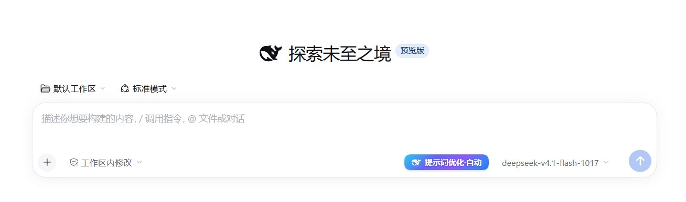
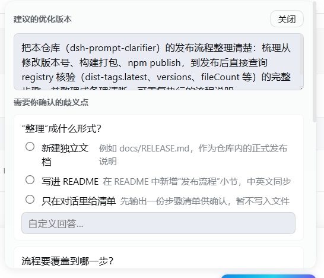

# dsh-prompt-clarifier

<p align="center">
  
</p>

<p align="center"><em>Captured in the composer: the <code>Prompt refine·On</code> button sits just left of the model selector.</em></p>

[简体中文](README.md) ｜ English

A "prompt refine" button for DeepSeek Harness: **before** your message is sent, it rewrites the prompt
to be more explicit using the current session context, and asks you about blocking ambiguities first.

## Features

- **Refine before sending** — a side-channel analysis runs before the message goes out and turns vague
  input into an explicit instruction (goal, scope, acceptance criteria). The rewrite becomes this turn's
  instruction; your original text stays in the conversation.
- **Clarify blocking ambiguities first** — when a decisive detail is missing (which button, which
  strategy, which environment), a question card opens with selectable options and free-form answers; the
  answer is merged into the turn, and on timeout the plugin proceeds on stated assumptions.
- **One card in the main conversation** — `1/3 read context` → `2/3 model analysis` →
  `3/3 clarification` → `result` accumulate in a single tool card while the turn runs; when the turn
  ends, the same card folds into that turn's collapsed "thinking" region, where you can expand it any
  time. It never enters the model context.
- **Failures never break the turn** — errors, timeouts and unparseable output only append one error line;
  the turn continues with your original input.

## Screenshots

<p align="center">
  
  &nbsp;&nbsp;
  
</p>

<p align="center"><em>Left: <code>Prompt refine·On</code> (blue gradient). Right: <code>Prompt refine·Off</code> (greyed out, switched by right-click).</em></p>

<p align="center">
  
</p>

<p align="center"><em>The panel that opens when you click the button: the refined prompt first, then the ambiguities it needs you to settle.</em></p>

For where the button sits in the composer control row see [Usage](#usage). The working state, the in-chat
card and the clarification card still need screenshots; they go into `docs/screenshots/` as well.

## Usage

The button sits in the composer area (below the input, left of the model selector):

- **Left click** — analyze the current input immediately (regardless of AUTO).
- **Right click** — toggle `Prompt refine·On` ↔ `Prompt refine·Off` (and swallow the browser context
  menu).
- Hover shows the full name and state: `Prompt refine (on)` / `Prompt refine (off)`.

Three button states:

| State | Label | Meaning |
| --- | --- | --- |
| Auto on | `Prompt refine·On` | every long-enough message is refined before sending |
| Auto off | `Prompt refine·Off` | analysis only when you trigger it (button greyed out) |
| Working | `Prompt refine` + three breathing dots | analyzing; button temporarily disabled, then restores |

Where it sits in the control row:

<p align="center">
  
</p>

<p align="center"><em>Plugin button in the middle, model selector and send key to the right.</em></p>

### Auto mode

1. Type and send a message (≥ 10 characters by default — see [Configuration](#configuration)).
2. Before it is sent, the plugin analyzes and rewrites it; a `Prompt refine` card appears in the main
   chat and accumulates three phases.
3. No ambiguity: the rewrite becomes this turn's instruction and the suggested version stays available in
   the panel.
4. Ambiguity found: a question card opens; pick options (or answer freely) and confirm — the answers are
   merged into the turn.

### The panel

- Shows the suggested refinement with **replace draft** (writes back to the composer) and **copy**; if
  writing back fails it offers "view text to paste" as a fallback.
- With questions, options are clickable and a "custom answer…" field is available.
- On errors it shows the reason and offers **retry**.

### What it never does

- It does not edit messages you already sent;
- It does not put progress rows into the model context (they are UI only);
- It does not end your turn because analysis failed;
- It does not analyze while you are still typing: the button only enters the working state after the
  message is really sent (typing, newlines and IME composition do not count).

## Installation

**Requirements**: DeepSeek Harness (desktop or Web GUI) and Node.js ≥ 20.

This package is a DSH **bundle**: `dsh.bundle.patch` in `package.json` points at `cordis.patch.yml`,
which inserts a Host plugin row named `prompt-clarifier` and registers a browser client module (the
button and panels live in that client).

### One-line install

```bash
# into the current profile (`desktop` → `web` / `tui` as needed)
dsh plugin --profile desktop add dsh-prompt-clarifier
```

Pin a version with `dsh plugin --profile desktop add dsh-prompt-clarifier@0.3.6`.

Without the `dsh` CLI (desktop-app-only installs), ask the assistant to install it — it uses
`plugin_manager`'s `install_bundle` to do the same installation and activation:

> Install the plugin: `dsh-prompt-clarifier`

The mechanics are the same: fetch the package from npm, install it into the profile, select the
bundle. Per the plugin guidelines, do **not** hand-write the profile's `package.json` /
`cordis.patch.yml`, and do not run `pnpm` in the profile directory.

Once installed, **Settings → Plugins (Plugin list)** can enable/disable the plugin row or remove the
bundle (`set_plugin` / `set_bundle` / `remove_bundle`); the title and description come from `meta` in
`locale/zh.json` / `locale/en.json`. If "page local sync failed" appears, retry as prompted — the
Host-side toggle is unaffected.

### Taking effect

- **Host side** (`index.js`, the `cordis.patch.yml` config) — requires a **Harness restart**;
- **Client side** (`client.js`) — a **page refresh** is enough; restart if the old UI persists.

### Verify the install

1. After restarting (or refreshing), the `Prompt refine·On` button appears in the composer;
2. Right-click switches it to `Prompt refine·Off` (greyed) and back;
3. Send a long-enough message: the `Prompt refine` card appears and accumulates three phases.

## Configuration

Configuration lives in the package's `cordis.patch.yml` (after installation, in the profile's loader
layer). Restart Harness to apply changes.

| Key | Default | Meaning |
| --- | --- | --- |
| `enabled` | `true` | master switch |
| `auto` | `true` | initial auto state (toggleable from the UI) |
| `askBlocking` | `true` | ask when ambiguities are found; `false` = rewrite only |
| `minChars` | `10` | auto mode ignores shorter input (manual trigger is unaffected) |
| `maxInputChars` | `8000` | skip analysis above this length (large pastes) |
| `contextItems` | `5` | how many recent messages are sampled as context |
| `contextItemChars` | `280` | characters taken from each sampled message |
| `timeoutMs` | `45000` | end-to-end limit for one side-channel analysis |
| `maxOutputTokens` | `2048` | output budget for the analysis (too small starves thinking → empty output) |
| `askTimeoutMs` | `180000` | question-card wait limit; on timeout it proceeds on assumptions |
| `showProgress` | `true` | show the 1/3, 2/3, 3/3 rows (`false` keeps only the result; error rows unaffected) |
| `fastProvider` / `fastModel` | `''` | manual fast route (both must be set); empty = use the selected model |
| `autoFast` | `false` | also route the per-message auto call through the fast route (quality first by default) |
| `timingLog` | `''` | file path for timing samples (debugging; empty = off) |

## Development notes

Implementation notes, fix history and test details live in `_docs/prompt-clarifier-internals.md`
(not part of the published package).

## License

MIT