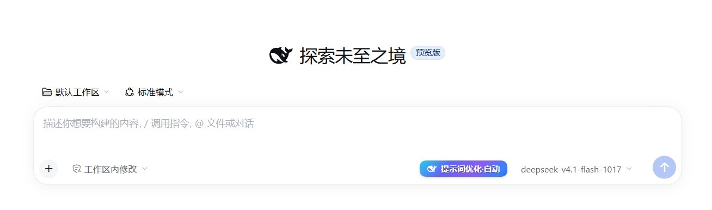

输入区实拍：`提示词优化·自动` 按钮就在模型选择器左侧，消息发出前自动分析、按需澄清。

# dsh-prompt-clarifier

简体中文 ｜ [English](README-en.md)

给 DeepSeek Harness 加一个「提示词优化」按钮：在你把消息发出去**之前**，先按会话上下文把提示词
改写得更明确；遇到「不确认就没法开工」的歧义时先向你提问，拿到答案再交给助手执行。

## 功能

- **输入前改写**：消息发出前做一次旁路分析，把含糊的输入补成明确的指令（目标、范围、验收标准）。
  改写结果作为本轮指令交给助手，原始输入仍保留在对话里。
- **歧义优先澄清**：缺少决定性信息（改哪个按钮、用哪种策略、跑在哪个环境）就无法开工时，先弹出
  提问卡片，选项可点选、也可自定义回答，答案并入本轮指令；超时无人作答则按假设继续，不卡回合。
- **主对话里的一张小卡片**：`1/3 读取上下文` → `2/3 模型分析` → `3/3 澄清提问` → `结果` 累积在
  同一张工具卡片里，回合进行中直接可见；回合结束后它随该回合收进「思考过程」折叠区，展开即可查看。
  它不打断对话流，也不占用模型上下文。
- **失败不中断**：模型报错、超时、返回内容无法解析时，只追加一行错误说明，本轮按原始输入继续。

按钮三态：

| 状态 | 按钮文案 | 含义 |
| --- | --- | --- |
| 自动开启 | `提示词优化·自动` | 每条够长的消息都会在发送前自动分析 |
| 自动关闭 | `提示词优化·关闭` | 只在你主动触发时分析（按钮置灰） |
| 进行中 | `提示词优化` + 三个呼吸圆点 | 正在分析；按钮临时禁用，结束后自动恢复 |

## 用法

按钮在输入区（输入框下方、模型选择器左侧）：

- **左键单击** = 立即分析当前输入（AUTO 开关不影响）。
- **右键单击** = 切换 `提示词优化·自动` ↔ `提示词优化·关闭`，并吞掉浏览器右键菜单。
- 悬停显示完整名称与状态：`提示词优化（开启）` / `提示词优化（关闭）`。

它在输入区控制行里的实际位置（中间是插件按钮，右侧是模型选择器与发送键）：


AUTO 开启时的近照：蓝色渐变底 + `提示词优化·自动`。右键点击即变成置灰的 `提示词优化·关闭`：


### 自动模式

1. 正常输入并发送一条消息（默认要求 ≥ 10 字，见[配置](#配置)）。
2. 消息发出前，插件按上下文分析并改写它；主对话里出现 `提示词优化` 卡片，依次累积三个阶段。
3. 没有歧义：改写稿作为本轮指令执行，面板里可查看「建议的优化版本」。
4. 有歧义：弹出提问卡片，选好后点确认，回答并入本轮指令。

### 面板

- 查看「建议的优化版本」，一键**替换草稿**（写回输入框）或**复制**；写回失败时给出
  「查看要粘贴的文本」兜底。
- 有提问时选项可直接点选，也可以填「自定义回答…」。
- 出错时显示原因，可点**重试**。

### 不会做的事

- 不修改你已发送的历史消息；
- 不把优化过程塞进模型上下文（进度只在界面上）；
- 不因分析失败中断你的回合；
- 不在你还在输入时提前分析：消息**真正发出**后才进入「提示词优化」
  （打字、换行、输入法组字都不算发送）。

## 安装

**前置条件**：已安装 DeepSeek Harness（桌面端或 Web GUI），Node.js ≥ 20。

本包是一个 DSH **bundle**：`package.json` 的 `dsh.bundle.patch` 指向 `cordis.patch.yml`，
安装后向 Host 插入一个 `prompt-clarifier` 插件行，并注册一个浏览器端 client
（网页端的按钮、面板都在这个 client 里）。

### 一键安装

```bash
# 装到当前 profile（`desktop` 换成 `web` / `tui` 即可）
dsh plugin --profile desktop add dsh-prompt-clarifier
```

也可以指定版本：`dsh plugin --profile desktop add dsh-prompt-clarifier@0.3.4`。

没有 `dsh` 命令行的环境（例如只装了桌面端），在 DSH 里让助手安装即可——助手用
`plugin_manager` 的 `install_bundle` 完成同样的安装与启用：

> 安装插件：`dsh-prompt-clarifier`

其实质与命令行一致：从 npm 取包、装进 profile、把 bundle 选中。按官方插件准则，
**不要**手工写 profile 的 `package.json` / `cordis.patch.yml`，也不要在 profile 目录里跑 `pnpm`。

安装后可在 **设置 → 插件（Plugin list）** 里启用/停用插件行，或移除 bundle（等价于
`set_plugin` / `set_bundle` / `remove_bundle`）；标题与说明来自本包 `locale/zh.json`、
`locale/en.json` 的 `meta`。出现「页面本地同步失败」时按提示重试即可，不影响 Host 侧开关。

### 生效方式

- **Host 侧**（`index.js`、`cordis.patch.yml` 的配置）改动 → **重启 Harness** 才加载；
- **客户端**（`client.js`）改动 → **刷新页面**即可，仍是旧界面再重启。

### 验证安装

1. 重启或刷新后，输入区出现 `提示词优化·自动` 按钮；
2. 右键点击切成 `提示词优化·关闭` 且按钮置灰，再右键切回；
3. 发一条够长的消息，主对话里出现 `提示词优化` 卡片并累积三个阶段。

## 配置

配置写在包的 `cordis.patch.yml` 里（安装后位于 profile 的 loader 层），改完重启 Harness 生效。

| 键 | 默认 | 说明 |
| --- | --- | --- |
| `enabled` | `true` | 插件总开关 |
| `auto` | `true` | 默认是否自动优化（按钮的初始状态，可在界面上切换） |
| `askBlocking` | `true` | 发现歧义时是否阻塞提问；`false` = 只改写、不提问 |
| `minChars` | `10` | 自动模式只处理不短于该长度的输入（手动触发不受限） |
| `maxInputChars` | `8000` | 超过则跳过分析（避免大段粘贴被误判） |
| `contextItems` | `5` | 采样最近多少条消息作为上下文 |
| `contextItemChars` | `280` | 每条上下文最多取多少字符 |
| `timeoutMs` | `45000` | 单次旁路分析的端到端上限 |
| `maxOutputTokens` | `2048` | 分析用的输出预算（过小会让思考吃满预算导致空输出） |
| `askTimeoutMs` | `180000` | 提问卡片等待上限，超时按假设继续 |
| `showProgress` | `true` | 卡片里是否显示 1/3、2/3、3/3 三条进度（关掉只留「结果」，错误行不受影响） |
| `fastProvider` / `fastModel` | `''` | 手动快速路由（两项都填才生效）；留空 = 用选择器选中的模型 |
| `autoFast` | `false` | 自动模式那次逐条调用是否也走快速路由（默认质量优先） |
| `timingLog` | `''` | 耗时打点落盘路径（排查用，留空关闭） |

## 截图

按钮的两张实机截图已放在[用法](#用法)里（`docs/screenshots/button-in-composer.png`、
`docs/screenshots/button-auto.png`）。其余待补，补齐后放进 `docs/screenshots/`：

- `docs/screenshots/button-off.png` — 右键切换后的 `提示词优化·关闭`（置灰）
- `docs/screenshots/button-busy.png` — 进行中的 `提示词优化` + 三个呼吸圆点
- `docs/screenshots/card-progress.png` — 累积三阶段的 `提示词优化` 卡片
- `docs/screenshots/clarify-panel.png` — 歧义提问卡片与「建议的优化版本」面板

内部实现、修复记录与测试细节见 `_docs/prompt-clarifier-internals.md`（不随包发布）。

## 许可

MIT